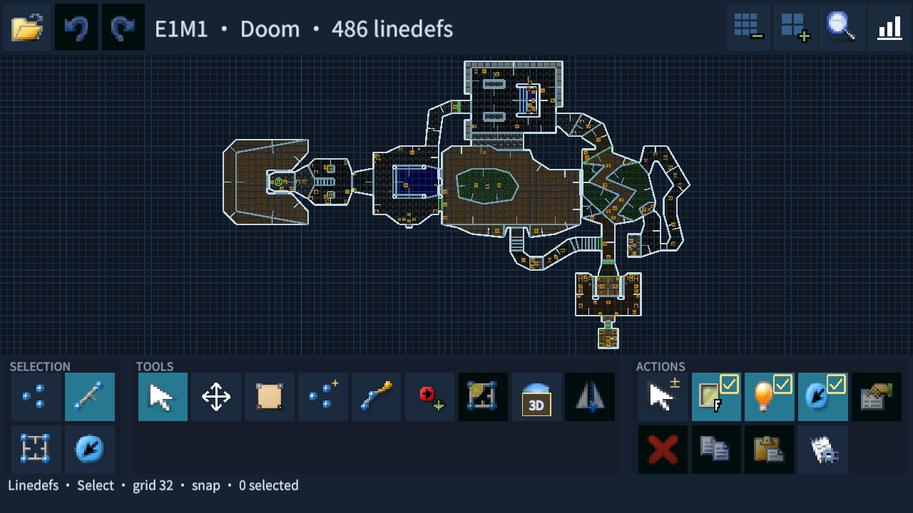
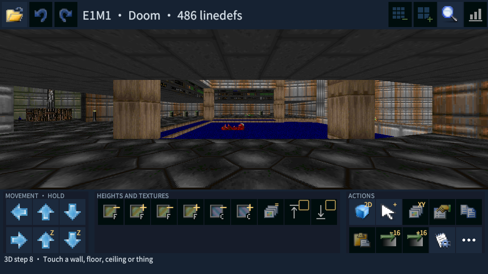

# Mobile Doom Builder

A touch-focused Doom map editor for Android, built with Unity.

Mobile Doom Builder is a mobile fork and adaptation of [Ultimate Doom Builder](https://github.com/UltimateDOOMBuilder/UltimateDOOMBuilder).

Create and edit maps directly on your phone or tablet, with grouped on-screen tools and an interactive 3D view.

## Features

- 2D map editing and interactive 3D editing.
- Classic Doom maps with Doom, Boom, MBF and MBF21 compatibility profiles.
- Vertex, linedef, sector and thing editing.
- Texture previews, alignment and offset controls.
- Sector joining and merging.
- Automap editing, sound propagation and blockmap views.
- WAD loading and saving, recent maps and recovery of the last editing session.
- Touch navigation with two-finger zoom.
- Three interface sizes: Large, Medium and Small.

## Supported Languages

English (default), Russian, French, German, Chinese (Simplified), Chinese (Traditional), Korean, Japanese, Portuguese (Brazil), Portuguese (Portugal) and Spanish.

Some translations are machine-generated and may need refinement.

## Screenshots

## Status

Version 0.5 is an early Android release under active development. UDMF and iOS are outside the scope of this release.

Built with **Unity 6000.3.5f2** and C#.

For desktop touch testing, hold **Alt**: the initial cursor position acts as the first finger, and the moving cursor acts as the second.

## Credits and License

Based on Ultimate Doom Builder and the work of its contributors, including the Doom Builder and GZDoom Builder projects.

The native node builder uses [ZDBSP](https://github.com/rheit/zdbsp), with its source and license included under `Native/Zdbsp`. Bundled zlib and Noto fonts retain their own licenses.

See [LICENSE.txt](LICENSE.txt) for the GPL-3.0 license. IWAD files are not included; provide your own WAD files. The original Doom sprite used for the application icon belongs to id Software.
